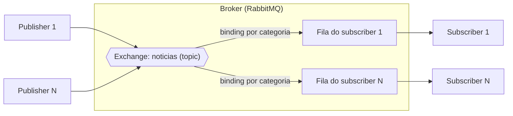

# Feed de Notícias em Tempo Real com Publish/Subscribe

- Disciplina: CIN0143, Sistemas Distribuídos (CIn-UFPE)
- Docente: David J M Cavalcanti
- Equipe: 04
- Tema: Publish/Subscribe com Message Broker
- Entrega: 1

| Integrante                         | Logins CIn |
| ---------------------------------- | ---------- |
| Caíque Machado Sena de Oliveira    | cmso       |
| João Gabriel Medeiros Caldas       | jgmc       |
| Ricardo Cunha Lira                 | rcl4       |
| Vinicius Lauter Figuerêdo Oliveira | vlfo       |
| Williams Andrade de Souza Filho    | wasf       |

## 1. Descrição do projeto

O sistema é um feed de notícias em tempo real. Publicadores publicam notícias categorizadas (por exemplo, tecnologia, esportes e cultura) em um broker. Inscritos assinam categorias, recebem título e resumo de forma assíncrona e podem mudar as assinaturas em tempo de execução. Não existe servidor central acoplado aos clientes.

Os clientes rodam no terminal. O publisher envia uma notícia com categoria, título e resumo para o broker. O subscriber digita comandos para assinar ou cancelar categorias e vê no terminal o título e o resumo das notícias que chegam. Na Entrega 1, o subscriber mínimo só assina categorias ao iniciar (opção `--assinar`), e os comandos interativos ficam para a próxima entrega.

## 2. Decisão tecnológica

Broker escolhido: RabbitMQ

Justificativa:

- Pub/sub: o RabbitMQ funciona com exchanges. O publisher manda a notícia para a exchange com a categoria como routing key, sem saber quem vai receber. A exchange do tipo topic encaminha a mensagem para as filas que assinaram aquela categoria. Por isso, o filtro por categoria é feito pelo próprio broker.
- Sem servidor central acoplado aos clientes: publishers e subscribers só se conectam ao broker e não se conhecem. Cada subscriber tem a sua fila, então um subscriber parado não atrapalha os outros.
- Assinatura dinâmica: assinar uma categoria é criar um binding da fila do subscriber na exchange, e cancelar é remover esse binding. O cliente faz isso direto no broker enquanto está rodando, sem precisar reiniciar nada.
- Ambiente local: a imagem `rabbitmq:4-management` já vem com a interface web, onde dá para ver exchanges, filas e bindings. Isso ajuda a mostrar as evidências da validação.

Essas características foram tiradas da documentação do RabbitMQ. Com o esqueleto do projeto, foram verificados o roteamento por categoria na exchange topic, a fila própria de cada subscriber e a criação de bindings ao iniciar o subscriber (seção 10). Os comandos interativos de assinar e cancelar ainda não foram implementados.

Linguagem e biblioteca cliente: Python 3 com pika client.

## 3. Arquitetura



Responsabilidades:

- Publisher: monta a notícia (categoria, título e resumo) e publica na exchange `noticias`, usando a categoria como routing key. Ele não sabe quantos subscribers existem nem quem vai receber a mensagem.
- Broker: recebe as mensagens na exchange e entrega uma cópia para cada fila que tem um binding compatível com a routing key. É o único ponto em comum entre publishers e subscribers, mas não tem regra de negócio da aplicação.
- Subscriber: cria a própria fila, cria e remove bindings conforme o usuário assina ou cancela categorias, e consome as mensagens de forma assíncrona. Ao receber uma notícia, exibe o título e o resumo no terminal.

Os clientes rodam no terminal e conversam somente com o broker. Por isso, não existe servidor central entre eles.

## 4. Topologia de tópicos e exchanges

Foi utilizada uma única exchange, chamada `noticias`, do tipo topic. Cada categoria de notícia é uma routing key, e os subscribers recebem apenas as categorias que assinaram.

| Propriedade             | Valor                                                                      |
| ----------------------- | -------------------------------------------------------------------------- |
| Nome                    | `noticias`                                                                 |
| Tipo                    | topic                                                                      |
| Durabilidade            | durável                                                                    |
| auto_delete             | não                                                                        |
| Quem declara a exchange | publisher e subscriber (declarar uma exchange que já existe não gera erro) |

Árvore de categorias (exemplo do enunciado):

```text
noticias
  tecnologia
  esportes
  cultura
```

No enunciado a árvore aparece como noticias/tecnologia. No RabbitMQ, `noticias` é o nome da exchange e a routing key é só a categoria. Por isso, a notícia de tecnologia é publicada na exchange `noticias` com a routing key `tecnologia`. Nesta entrega não há subcategorias, então cada routing key tem uma palavra só.

Routing keys e categorias permitidas:

| Categoria       | Routing key  | Descrição                                        |
| --------------- | ------------ | ------------------------------------------------ |
| tecnologia      | `tecnologia` | Notícias de tecnologia                           |
| esportes        | `esportes`   | Notícias de esportes                             |
| cultura         | `cultura`    | Notícias de cultura                              |
| Tópico de teste | `teste`      | Usado somente na validação da comunicação básica |

Os clientes aceitam essas quatro routing keys. A routing key `teste` existe só para validar a comunicação básica e não é uma categoria de notícia do feed.

Uso de wildcards:

- No topic exchange, o `*` substitui exatamente uma palavra e o `#` substitui zero ou mais palavras.
- O cliente aceita na assinatura o nome exato de uma categoria permitida ou `#`. Qualquer outro padrão é recusado, inclusive `*`.
- Como as routing keys têm uma palavra só, o `#` casa com todas elas, inclusive com `teste`. Portanto, um subscriber com `#` ativo também recebe as mensagens de teste.
- Se a mesma fila tiver `#` e uma categoria (por exemplo, `esportes`), existem dois bindings, mas cada notícia é entregue uma vez só na fila (verificado, seção 10).
- Cancelar uma categoria não adianta se o `#` estiver ativo, porque o `#` continua casando com ela (verificado, seção 10). Para parar de receber uma categoria, é preciso cancelar o `#` e assinar as outras categorias.

## 5. Formato da mensagem

As notícias são enviadas como JSON em UTF-8, no corpo da mensagem, com `content_type` igual a `application/json`. A categoria aparece duas vezes: na routing key (usada pelo broker para entregar) e no campo `categoria` (usado pelo subscriber para exibir e conferir).

| Campo          | Tipo   | Obrigatório | Regra de validação                                                                   |
| -------------- | ------ | ----------- | ------------------------------------------------------------------------------------ |
| `id`           | string | sim         | UUID na forma padrão, com hifens (por exemplo, o gerado por `uuid4`)                 |
| `categoria`    | string | sim         | Deve estar na lista de categorias permitidas e ser igual à routing key               |
| `titulo`       | string | sim         | Não pode ser vazio nem ter só espaços, no máximo 100 caracteres                      |
| `resumo`       | string | sim         | Não pode ser vazio nem ter só espaços, no máximo 300 caracteres                      |
| `publicado_em` | string | sim         | ISO 8601 com data, hora e fuso (`Z` ou `+hh:mm`), por exemplo `2026-11-17T19:30:00Z` |

Exemplo sintético:

```json
{
  "id": "3f2b8c1e-5d4a-4c7e-9b61-0a1d2e3f4a5b",
  "categoria": "tecnologia",
  "titulo": "Exemplo de título da notícia",
  "resumo": "Exemplo de resumo com uma ou duas frases sobre a notícia.",
  "publicado_em": "2026-11-17T19:30:00Z"
}
```

Validações:

- Campos obrigatórios: `id`, `categoria`, `titulo`, `resumo` e `publicado_em`. Se algum faltar, a mensagem é inválida. Não existe campo extra: se uma mensagem trouxer um campo a mais, ele é ignorado.
- Tipos: todos os campos são strings.
- Categorias permitidas: `tecnologia`, `esportes` e `cultura` (mais `teste`, só para a validação da comunicação básica).
- Limites de tamanho: título com até 100 caracteres e resumo com até 300 caracteres.
- Data: `publicado_em` é gerado em UTC, com sufixo `Z`, e o validador também aceita outro fuso no formato `+hh:mm`.
- Id do subscriber: o `--id` aceita letras, dígitos, `-` e `_`, de 1 a 32 caracteres, e é validado antes de conectar. Ele forma o nome da fila (`fila.<id>`).

Onde a validação acontece:

- Publisher: monta e valida a notícia antes de conectar ao broker. Se for inválida, mostra os erros, sai com código 1 e não envia nada. A routing key também precisa ser uma categoria permitida.
- Subscriber: valida cada mensagem recebida. Se o JSON estiver quebrado, faltar campo ou a categoria for diferente da routing key, mostra um aviso no terminal e descarta a mensagem com `basic_nack(requeue=False)`, para ela não ser reentregue em loop. O subscriber continua rodando. Como o projeto não tem dead-letter exchange, a mensagem descartada é perdida.

A validação nos dois lados tem uma razão: o broker não valida o corpo da mensagem, e qualquer cliente com acesso à exchange pode publicar nela, sem usar o publisher do projeto. Além disso, só o subscriber consegue conferir a categoria contra a routing key usada na entrega. Por isso, o publisher evita enviar mensagens inválidas, e o subscriber não confia no que chega.

As regras ficam em `src/mensagem.py`, usado pelos dois lados, e os casos válidos e inválidos estão em `testes/test_mensagem.py`.

## 6. Modelagem do estado central

Não existe servidor de aplicação, por isso o estado fica dividido entre o broker e os clientes. O publisher não guarda estado: ele monta a notícia, valida e envia, sem registro local. Foram utilizadas filas duráveis, para que um subscriber offline não perca as notícias das categorias que já tinha assinado.

| Dado                          | Onde vive                                 | Durável ou volátil | Observação                                                                                                |
| ----------------------------- | ----------------------------------------- | ------------------ | --------------------------------------------------------------------------------------------------------- |
| Exchange `noticias`           | Broker                                    | Durável            | Declarada com `durable=True`, pelo publisher e pelo subscriber                                            |
| Filas                         | Broker                                    | Durável            | Uma por subscriber, chamada `fila.<id>`, com `durable=True`, `exclusive=False` e `auto_delete=False`      |
| Bindings (fila e routing key) | Broker                                    | Durável            | Pertencem à fila e continuam depois que o subscriber encerra                                              |
| Mensagens em trânsito         | Broker, dentro da fila de cada subscriber | Durável            | Publicadas com `DeliveryMode.Persistent`, ficam na fila até o ack do subscriber                           |
| Lista de assinaturas ativas   | Subscriber, em memória                    | Volátil            | Zerada quando o subscriber é reiniciado, mas os bindings continuam no broker (ponto em aberto da seção 7) |
| Categorias permitidas         | `src/config.py`                           | Durável            | Fica no código, e a mesma lista é usada pelo publisher e pelo subscriber                                  |
| Parâmetros de conexão         | `src/config.py`                           | Durável            | Credenciais no código, válidas só para ambiente local                                                     |

Quando o subscriber está offline, as mensagens ficam na fila dele e chegam quando ele reconecta com o mesmo id. Isso vale apenas para as categorias que tinham binding no momento da publicação. Se nenhuma fila tiver binding para a routing key, o broker descarta a mensagem. Depois do ack, a mensagem sai da fila, e o broker não guarda histórico de notícias.

O subscriber usa ack manual (`auto_ack=False`) e `basic_qos(prefetch_count=1)`. Dessa forma, o broker só entrega a próxima mensagem depois do ack da anterior, e uma mensagem não confirmada deve voltar para a fila se a conexão cair (comportamento descrito na documentação do RabbitMQ, não testado).

Se o broker for reiniciado, a exchange, a fila, o binding e a mensagem persistente continuam existindo, porque o `compose.yaml` monta o volume `rabbitmq_data` em `/var/lib/rabbitmq`. Isso foi verificado com `docker compose restart rabbitmq` e uma mensagem (seção 10).

## 7. Assinaturas dinâmicas

Cada subscriber muda os bindings da própria fila diretamente no broker, sem servidor intermediário. Nesta entrega, essa mudança só acontece ao iniciar o subscriber. Os comandos interativos estão modelados abaixo e serão implementados na próxima entrega.

Inicialização do subscriber (implementada):

1. O usuário informa o `--id` (por exemplo, `sub1`), que é validado.
2. O subscriber declara a exchange `noticias` e a fila `fila.<id>` (durável, não exclusiva e sem `auto_delete`). Se a fila já existe, ela é reaproveitada.
3. Sem a opção `--assinar`, o subscriber inicia sem nenhuma categoria assinada e não cria nenhum binding nessa execução.
4. A opção `--assinar <padrão>` pode ser repetida e existe só para o teste desta entrega. Cada padrão (categoria permitida ou `#`) vira um binding da fila na exchange. Padrões repetidos são ignorados, e qualquer outro padrão, inclusive `*`, faz o subscriber recusar a execução.
5. O subscriber começa a consumir de forma assíncrona e mostra categoria, título e resumo de cada notícia válida.

Encerrar o subscriber com Ctrl+C não apaga a fila nem os bindings. Isso também vale para o comando `sair`, previsto para a próxima entrega.

Fluxo de assinar:

1. O usuário digita o comando de assinar com um padrão (por exemplo, `assinar esportes`).
2. O subscriber confere se o padrão é uma categoria permitida ou `#`, e se ainda não está na lista local.
3. O subscriber cria um binding entre a sua fila e a exchange `noticias`, usando o padrão como routing key.
4. O padrão entra na lista local de assinaturas ativas e o terminal mostra uma confirmação.
5. A partir daí, as notícias que casam com o padrão passam a chegar na fila do subscriber.

Fluxo de cancelar:

1. O usuário digita o comando de cancelar com um padrão (por exemplo, `cancelar esportes`).
2. O subscriber confere se o padrão está na lista local de assinaturas ativas.
3. O subscriber remove o binding da sua fila com a exchange.
4. O padrão sai da lista local e o terminal mostra uma confirmação.
5. As notícias novas deixam de chegar. Mensagens que já estavam na fila antes do cancelamento ainda podem ser entregues.

Comandos do cliente subscriber (modelados, nomes a confirmar):

| Comando             | Efeito                                                               |
| ------------------- | -------------------------------------------------------------------- |
| `assinar <padrão>`  | Cria o binding e adiciona o padrão à lista                           |
| `cancelar <padrão>` | Remove o binding e tira o padrão da lista                            |
| `listar`            | Mostra as assinaturas ativas no momento                              |
| `sair`              | Fecha a conexão com o broker e encerra o subscriber, mantendo a fila |

Regras do `#`:

- Assinar `#` e uma categoria cria dois bindings na mesma fila, mas a notícia é entregue uma vez só.
- Com `#` ativo, cancelar uma categoria não adianta, porque o `#` continua casando com ela.
- Cancelar o `#` remove só esse binding, e as categorias assinadas separadamente continuam ativas.
- O `#` também casa com a routing key `teste`.

Funcionamento sem servidor central:

- Cada subscriber conversa só com o broker, que é o único ponto em comum do sistema. Não há servidor de aplicação para registrar ou repassar as assinaturas.
- Como cada subscriber tem a própria fila, mudar as assinaturas de um não afeta os outros.
- Se o usuário assinar um padrão inválido, o comando é recusado com uma mensagem de erro. Se o padrão já estiver assinado, o subscriber apenas avisa e não cria outro binding.

Ponto em aberto: recuperação da lista local ao reconectar com o mesmo id.

Como a fila é durável, os bindings continuam no broker quando o subscriber encerra. Ao reconectar com o mesmo id, a fila volta a receber as categorias antigas (verificado com `--id` repetido e sem `--assinar`), mas a lista local de assinaturas começa vazia. Por isso, o comando `listar` não mostraria o que está realmente ativo.
- Opção A: consultar a API HTTP de management (`GET /api/queues/%2F/fila.<id>/bindings`) e montar a lista a partir dos bindings da exchange `noticias`. Mantém o broker como única fonte da verdade, mas passa a depender do plugin de management e de uma segunda conexão (HTTP).
- Opção B: guardar a lista em um arquivo local por id. É simples e não depende do management, mas o arquivo pode divergir do broker se os bindings forem alterados por outro meio (por exemplo, pela interface de management).

## 8. Estrutura de pastas

```text
.
├── .gitignore
├── LICENSE
├── README.md
├── compose.yaml
├── requirements.txt
├── src
│   ├── config.py
│   ├── mensagem.py
│   ├── publisher.py
│   └── subscriber.py
└── testes
    └── test_mensagem.py
```

| Item                      | Descrição                                                                                                              |
| ------------------------- | ---------------------------------------------------------------------------------------------------------------------- |
| `.gitignore`              | Arquivos ignorados pelo git (template para Python, com entradas para RabbitMQ).                                        |
| `LICENSE`                 | Licença do projeto.                                                                                                    |
| `README.md`               | Documentação da entrega (este arquivo).                                                                                |
| `compose.yaml`            | Sobe o RabbitMQ (imagem `rabbitmq:4-management`) com as portas 5672 e 15672 e o volume `rabbitmq_data`.                |
| `requirements.txt`        | Dependências Python (pika 1.3.2).                                                                                      |
| `src/config.py`           | Parâmetros de conexão (hardcoded, só para ambiente local), nome da exchange, prefixo das filas, categorias e limites.  |
| `src/mensagem.py`         | Criação e validação da mensagem, do padrão de assinatura e do id do subscriber, usado pelos dois lados.                |
| `src/publisher.py`        | Publisher: recebe categoria, título e resumo, valida e publica na exchange `noticias`.                                 |
| `src/subscriber.py`       | Subscriber: declara a fila `fila.<id>`, cria os bindings pedidos em `--assinar`, consome e mostra as notícias válidas. |
| `testes/test_mensagem.py` | Testes unitários (unittest) das validações de `src/mensagem.py`.                                                       |

## 9. Como rodar

Todos os comandos abaixo são executados na raiz do repositório.

Pré-requisitos:

- Docker 29.9.2 e Docker Compose 5.6.1.
- Python 3.14.8 e pip.

Subir o broker:

```bash
docker compose up -d
```

Instalar dependências:

```bash
python3 -m venv .venv
source .venv/bin/activate

pip install -r requirements.txt
```

Rodar o subscriber (um terminal por subscriber):

```bash
# assina a routing key de teste com o id sub1
python src/subscriber.py --id sub1 --assinar teste

# sem --assinar, o subscriber inicia sem nenhuma categoria assinada
python src/subscriber.py --id sub1

# a opcao --assinar pode ser repetida (categoria permitida ou #)
python src/subscriber.py --id sub2 --assinar esportes --assinar cultura
```

Rodar o publisher (categoria, título e resumo, nessa ordem):

```bash
# publica uma noticia de tecnologia
python src/publisher.py tecnologia "Título da notícia" "Resumo da notícia."
```

Rodar os testes unitários:

```bash
# roda os testes do validador
python -m unittest discover -s testes -v
```

Interface de management (portas e credenciais definidas no `compose.yaml`):

- URL: http://localhost:15672
- Usuário: admin
- Senha: admin

A API HTTP respondeu a esse login durante a validação. A tela web não foi aberta (ver seção 10).

Parâmetros de conexão: host `localhost`, porta 5672, usuário `admin` e senha `admin`. Esses valores estão escritos diretamente em `src/config.py`, e valem só para o ambiente local desta disciplina.

Encerrar o ambiente:

```bash
# para e remove os containers, mantendo o volume
docker compose down

# para e remove os containers e o volume (apaga as filas e as mensagens)
docker compose down -v
```

## 10. Validação da comunicação básica

Verificado com Docker 29.9.2, Docker Compose 5.6.1, RabbitMQ 4.4.0 (imagem `rabbitmq:4-management`), Python 3.14.8 e pika 1.3.2. A captura de tela da interface de management ainda está pendente.

O teste usa a routing key `teste`. Um subscriber mínimo (`--id sub1 --assinar teste`) assina essa routing key e um publisher mínimo publica uma mensagem nela. Os terminais foram executados em segundo plano, por isso a saída do subscriber foi lida de um arquivo de log.

Passo a passo:

1. Subir o broker com `docker compose up -d` e conferir o container com `docker compose ps`. Resultado: container `rabbitmq` com status `Up` e as portas 5672 e 15672 publicadas.
2. Rodar os testes unitários com `python -m unittest discover -s testes -v`. Resultado: 26 testes, todos com `OK`.
3. Iniciar o subscriber mínimo.
4. Publicar uma mensagem de teste com o publisher mínimo.
5. Confirmar que o subscriber mostrou a mensagem no terminal.
6. Publicar uma mensagem com outra routing key (`esportes`) e confirmar que o subscriber não recebe, já que só assinou `teste`.
7. Conferir exchange, fila e binding no broker.

Terminal do subscriber (passos 3 e 5):

```text
Subscriber 'sub1' conectado. Fila: fila.sub1
Assinaturas pedidas: teste
Aguardando notícias (Ctrl+C para sair).
[teste] Mensagem de teste
    Primeira notícia de teste da comunicação com o broker.
```

Terminal do publisher (passo 4, código de saída 0):

```text
Notícia publicada em noticias com routing key 'teste':
{
  "id": "7475532f-e540-4149-b0c0-828a62909d43",
  "categoria": "teste",
  "titulo": "Mensagem de teste",
  "resumo": "Primeira notícia de teste da comunicação com o broker.",
  "publicado_em": "2026-11-17T22:47:21Z"
}
```

Depois da publicação em `esportes` (passo 6), o terminal do subscriber não mostrou nenhuma linha nova.

Estado no broker (passo 7), consultado pela API HTTP de management:

```text
exchange: {'name': 'noticias', 'type': 'topic', 'durable': True, 'auto_delete': False}
fila: {'name': 'fila.sub1', 'durable': True, 'exclusive': False, 'auto_delete': False}
bindings: noticias -> fila.sub1 rk= teste
```

A fila também tem o binding automático da exchange padrão (`(default) -> fila.sub1`), que o RabbitMQ cria para toda fila. Uma mensagem lida da fila sem ser consumida tinha `delivery_mode: 2`, `content_type: application/json` e `routing_key: teste`.

Teste extra (a): subscriber offline recebe ao reconectar com o mesmo id.

1. O subscriber `sub1` foi encerrado com Ctrl+C e mostrou `Encerrando (a fila continua no broker).`
2. Foram publicadas duas mensagens em `teste` com o subscriber parado.
3. O subscriber foi iniciado de novo com `--id sub1`, sem `--assinar`.

```text
Subscriber 'sub1' conectado. Fila: fila.sub1
Nenhuma categoria assinada nesta execução.
Aguardando notícias (Ctrl+C para sair).
[teste] Offline 1
    Primeira mensagem enviada com o subscriber parado.
[teste] Offline 2
    Segunda mensagem enviada com o subscriber parado.
```
